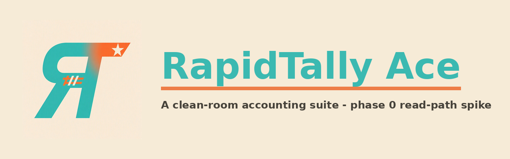

<div align="center">



# RapidTally Ace

**An independent, clean-room, cross-platform accounting suite — phase 0: QuickBooks Desktop read-path spike**

[](https://github.com/maniesh-NR/RapidTally-Ace/actions/workflows/ci.yml)
[](https://github.com/maniesh-NR/RapidTally-Ace/releases)
[](#license--attribution)


</div>

---

## What is this?

**RapidTally Ace** (formerly codenamed *Bookwright*) is an independent, clean-room
accounting suite for people who want to keep owning their books locally — with
first-class support for reading **Intuit QuickBooks Desktop** database files
(`.QBW` / `.QBB`).

This repository currently contains the **phase-0 spike**: a structural probe
library and CLI that inspects QuickBooks Desktop database files and reports

- ASCII signature hits (`SQL Anywhere`, `Adaptive Server`, `Sybase`, `Intuit`, `QuickBooks`),
- candidate SAP SQL Anywhere page sizes (file-size divisibility + header field scan),
- a per-region Shannon-entropy map (cleartext vs obfuscated/encrypted/compressed pages),
- a hex dump of the first page,

plus the full clean-room engineering, legal and release scaffolding for the
phases that follow (see [`docs/ROADMAP.md`](docs/ROADMAP.md)).

> **This is not an accounting application yet, and it is not affiliated with
> or endorsed by Intuit Inc.** QuickBooks is a trademark of Intuit Inc.

## Downloads (v0.1.0)

Grab the latest build from the
[Releases page](https://github.com/maniesh-NR/RapidTally-Ace/releases):

| Asset | Platform | Minimum OS |
|---|---|---|
| `rapidtally-ace-0.1.0-windows-x86_64.zip` | Windows 64-bit | Windows 7 SP1+ |
| `rapidtally-ace-0.1.0-windows-i686.zip` | Windows 32-bit | Windows 7 SP1+ |
| `rapidtally-ace-0.1.0-macos-x86_64.zip` | macOS (Intel) | macOS 10.15 Catalina+ |
| `rapidtally-ace-0.1.0-macos-universal2.zip` | macOS (Intel + Apple Silicon) | macOS 11+ |
| `rapidtally-ace-0.1.0-android-arm64-v8a.zip` | Android armv8a (validation artifacts) | Android 8.0 Oreo (API 26)+ |
| `rapidtally-ace-0.1.0-android-armeabi-v7a.zip` | Android armv7 (validation artifacts) | Android 8.0 Oreo (API 26)+ |
| `rapidtally-ace-0.1.0-linux-x86_64.tar.gz` | Linux, fully static binary | Any distro — Linux Mint 20–22 (Cinnamon / Xfce / MATE), Debian 11+, … |
| `rapidtally-ace_0.1.0_amd64.deb` | Linux `.deb` package | Mint / Debian / Ubuntu |
| `RapidTallyAce-0.1.0-x86_64.flatpak` | Flatpak bundle | Any distro with Flatpak |
| `SHA256SUMS.txt` | Checksums for everything above | — |

Install notes (Gatekeeper, Windows CRT, Flatpak) live in
[`docs/PLATFORMS.md`](docs/PLATFORMS.md) and in each release's notes.

## Build from source

The toolchain is pinned to **Rust 1.77.2** (the last Rust release that targets
Windows 7) via [`rust-toolchain.toml`](rust-toolchain.toml) — rustup installs it
automatically:

```bash
git clone https://github.com/maniesh-NR/RapidTally-Ace.git
cd RapidTallyAce
cargo test --workspace
cargo build --release
./target/release/rapidtally-ace --help
```

## Usage

```text
$ rapidtally-ace inspect sample.qbw
RapidTally Ace 0.1.0 - clean-room format probe (phase 0)
file: sample.qbw
file size            : 14336000 bytes
classification       : SQL Anywhere database - cleartext pages (low confidence)
markers              :
  - "SQL Anywhere" @ 0x00000160
page-size candidates : 1024, 2048, 4096
entropy              : mean 0.87 bits/byte across 16 regions
...
```

(Output is illustrative — the probe reports heuristics, not a verified parse.
No real QuickBooks data files are shipped in this repository.)

## Repository map

| Path | Contents |
|---|---|
| `crates/rapidtally-format/` | Probe library: marker scan, page-size heuristics, entropy map, hexdump, C ABI |
| `crates/rapidtally-cli/` | `rapidtally-ace` command-line front end |
| `docs/CLEANROOM.md` | Clean-room engineering protocol (mandatory read for contributors) |
| `docs/ROADMAP.md` | Phase plan and decision gates (G0/G1) |
| `docs/PLATFORMS.md` | Platform matrix, artifacts and caveats |
| `docs/ATTRIBUTION.md` | AI assistance, logo and prior-art attribution |
| `packaging/` | Debian, Flatpak and Android packaging |
| `.github/release-notes/` | Release notes shipped with each version |

## License & attribution

- **Code & docs:** licensed under the **GNU Affero General Public License
  v3.0** ([`LICENSE`](LICENSE)).
- **AI attribution:** RapidTally Ace v0.1.0 was built with the assistance of
  **GLM-5.3-Flash**, a large language model developed by **Z.ai**, under the
  direction of the project owner — see
  [`docs/ATTRIBUTION.md`](docs/ATTRIBUTION.md) and [`NOTICE.md`](NOTICE.md).
- **Logo:** © the RapidTally Ace project owner, used with permission.
- **Clean-room:** no Intuit source code, SDK binaries or proprietary assets are
  included or derived — see [`docs/CLEANROOM.md`](docs/CLEANROOM.md).
